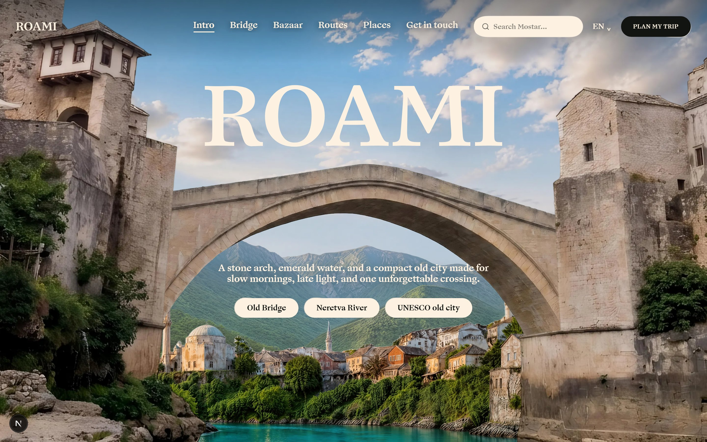
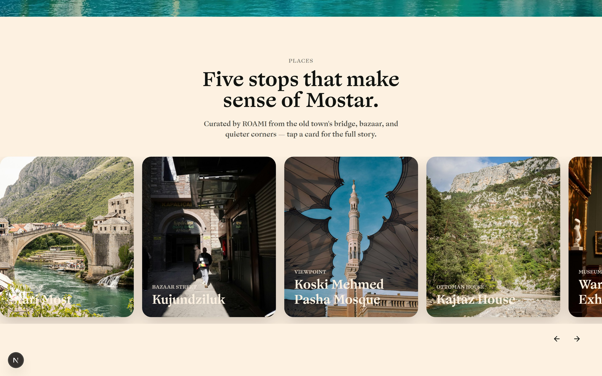
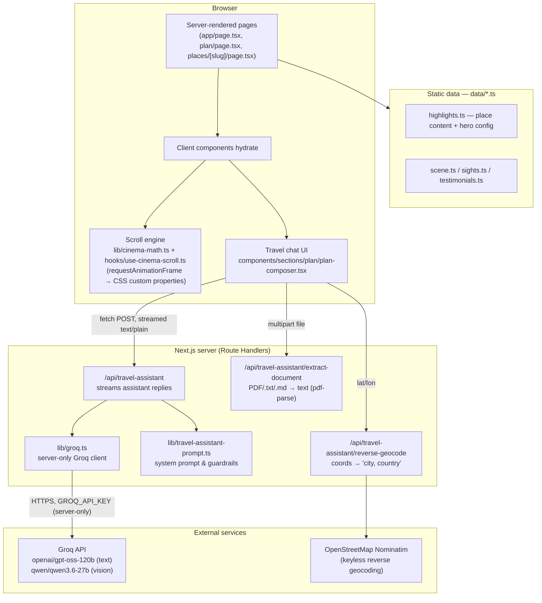
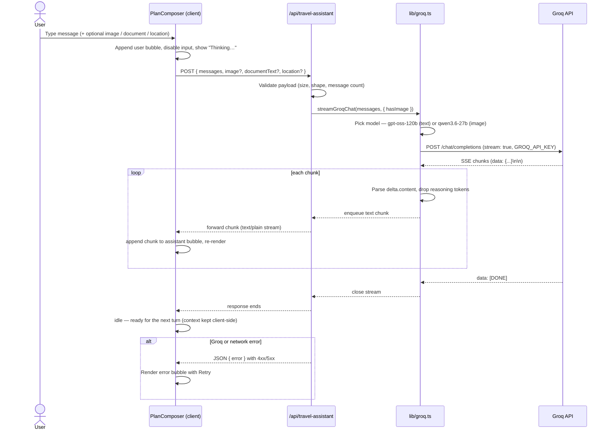
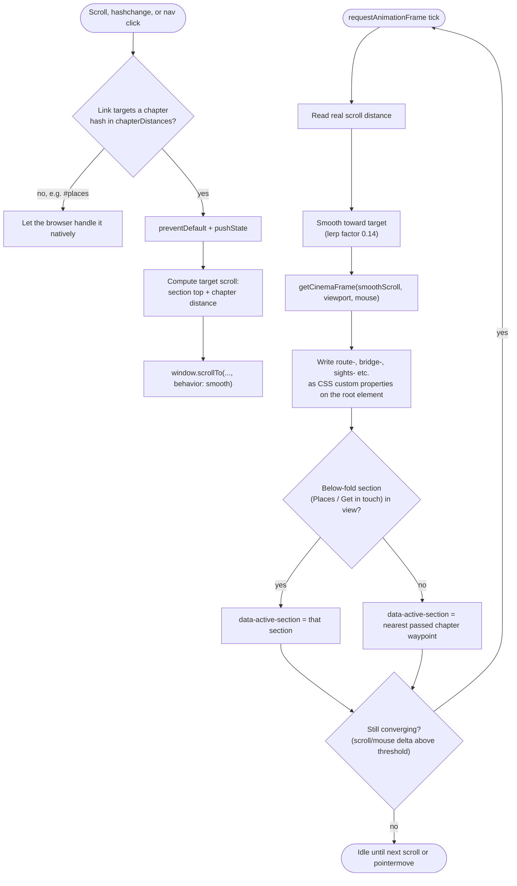

# ROAMI

> A cinematic travel experience for Mostar, Bosnia and Herzegovina — a scroll-driven story on the homepage, three landmark pages, and an AI travel-planning assistant.

[](https://nextjs.org/)
[](https://reactjs.org/)
[](https://www.typescriptlang.org/)
[](https://tailwindcss.com/)
[](https://bun.sh/)

<p align="center">
  
  <br>
  <em>The cinematic homepage: chapter one of the pinned scroll story.</em>
</p>

<p align="center">
  
  <br>
  <em>Places: five landmark cards, each opening into the full story.</em>
</p>

## Table of Contents

- [Overview](#overview)
- [Features](#features)
- [Architecture](#architecture)
- [AI Travel Assistant flow](#ai-travel-assistant-flow)
- [Cinema-scroll activity flow](#cinema-scroll-activity-flow)
- [Tech Stack](#tech-stack)
- [Project Structure](#project-structure)
- [Installation & Setup](#installation--setup)
- [Environment Configuration](#environment-configuration)
- [Available Scripts](#available-scripts)
- [Key Systems](#key-systems)
- [Content Management](#content-management)
- [Deployment](#deployment)
- [Testing](#testing)
- [Contributing](#contributing)

## Overview

ROAMI is a Next.js App Router site built around one long cinematic scroll on the homepage, three landmark detail pages with different hero treatments, and an AI trip-planning assistant. There is no CMS and no database — content lives in typed `data/*.ts` files, and the one piece of runtime intelligence is a Groq-backed chat assistant reached from the `/plan` page.

## Features

**Cinematic homepage**
- A single pinned scroll stage (`.cinema-scroll`) driving four chapters — intro, bridge, bazaar, and the sights slider — through hand-written scroll math (`lib/cinema-math.ts`), not a scroll-animation library.
- Mouse parallax, reduced-motion support, and a nav bar whose active link tracks the current chapter (and the below-fold Places / Get in touch sections) via a `data-active-section` attribute.

**Place pages**
- Three hero variants — boomerang (video plays forward/reverse on scroll), fade, and glass — chosen per landmark in `data/highlights.ts`.
- Shared scroll-exit animation (`hooks/use-hero-scroll-exit.ts`) so every hero leaves the screen the same way.

**AI Travel Assistant** (`/plan`)
- A real conversational trip planner backed by Groq, built directly into the existing composer UI — no separate chat widget.
- Multi-turn context, budget- and location-aware itineraries, image analysis (screenshots, destination photos), and PDF/text document uploads.
- See [AI Travel Assistant flow](#ai-travel-assistant-flow) below for the full request/response sequence.

**UI/UX**
- Responsive down to phone widths, ARIA labels and keyboard navigation throughout, `prefers-reduced-motion` respected everywhere animation happens.

## Architecture



The scroll engine and the AI assistant are the two pieces of real logic in this app; everything else is typed data rendered through components. Both are detailed below.

## AI Travel Assistant flow

The assistant is reached from the same composer that's always been on `/plan` — sending the first message is what turns it into a chat. Every turn (text, image, or document) goes through one streaming round trip:



Key points that shape the implementation:
- **The API key never reaches the browser.** `lib/groq.ts` is guarded with `import "server-only"`; only the Route Handler calls it.
- **Model choice is automatic**, not user-facing: any turn with an attached image uses the vision model, everything else uses the text model.
- **Conversation state lives in the client**, not the server — the whole message history is resent each turn (capped at 40 messages, 8000 chars/message) so the assistant can apply changes like "make it cheaper" to the existing plan.

## Cinema-scroll activity flow

The homepage's chapter navigation (nav-bar clicks, direct `#hash` links, and raw scrolling) all funnel through the same decision logic in `hooks/use-cinema-scroll.ts`:



`data-active-section` is what the nav bar's underline reads from — no separate scroll-spy library, just one more output of the same per-frame calculation that drives the animation itself.

## Tech Stack

**Core**
- [Next.js 16](https://nextjs.org/) (App Router, Turbopack) · [React 19](https://reactjs.org/) · [TypeScript 5](https://www.typescriptlang.org/)

**Styling**
- [Tailwind CSS 4](https://tailwindcss.com/) (CSS-first `@theme` config, no `tailwind.config.js`) · [Radix UI](https://www.radix-ui.com/) primitives (Popover, Dialog) · [class-variance-authority](https://cva.style/)

**Animation**
- Hand-written scroll math + `requestAnimationFrame` + CSS custom properties for the cinema engine (see [Architecture](#architecture)) · [Framer Motion](https://www.framer.com/motion/) for discrete UI transitions (carousels, dialogs, testimonials)

**AI**
- [Groq API](https://console.groq.com/) — `openai/gpt-oss-120b` for text/reasoning, `qwen/qwen3.6-27b` for image analysis · [pdf-parse](https://www.npmjs.com/package/pdf-parse) for document text extraction · OpenStreetMap Nominatim for keyless reverse geocoding

**Tooling**
- [Bun](https://bun.sh/) as package manager, dev/test runner · ESLint 9 · `bun test` + [happy-dom](https://github.com/capricorn86/happy-dom)

> `gsap` is listed in `package.json` but is not imported anywhere in the codebase — the scroll animation is entirely the custom engine above.

## Project Structure

```
ROAMI/
├── app/
│   ├── api/travel-assistant/
│   │   ├── route.ts                    # Streaming chat endpoint
│   │   ├── extract-document/route.ts   # PDF/.txt/.md → text
│   │   └── reverse-geocode/route.ts    # coords → "city, country"
│   ├── places/[slug]/page.tsx          # Dynamic landmark pages
│   ├── plan/page.tsx                   # Trip planner page
│   ├── not-found.tsx                   # Branded 404
│   ├── icon.svg                        # Favicon
│   ├── layout.tsx / page.tsx
│   ├── globals.css
│   └── styles/                         # cinema.css, plan.css, places.css, home-sections.css, scroll-exit.css
├── components/
│   ├── animations/                     # cinema-controller, ambient-video, scroll-exit-stage
│   ├── layout/                         # site-header, site-footer
│   ├── sections/
│   │   ├── home/                       # cinematic-home, sights-slider, places-carousel, showcase-grid, ...
│   │   ├── places/                     # boomerang-hero, fade-hero, glass-hero, place-hero
│   │   └── plan/                       # plan-hero, plan-composer (the AI chat UI)
│   └── ui/                             # button, input, apple-cards-carousel, animated-testimonials, ...
├── data/                               # highlights, navigation, scene, sights, testimonials
├── hooks/                              # use-cinema-scroll, use-hero-scroll-exit
├── lib/
│   ├── cinema-math.ts                  # Scroll → CSS-variable frame calculations
│   ├── groq.ts                         # Server-only Groq client + streaming
│   ├── travel-assistant-prompt.ts      # System prompt & guardrails
│   ├── format-message.tsx              # Plain-text → styled chat bubbles
│   └── utils.ts
├── public/{fonts,videos}/
├── tests/                              # bun test suite
└── types/
```

## Installation & Setup

**Prerequisites:** [Bun](https://bun.sh/) 1.3.14+ (or Node.js 20+ for compatibility).

```bash
git clone <this-repository-url>
cd ROAMI
bun install
```

Create a `.env` file in the project root (see [Environment Configuration](#environment-configuration)), then:

```bash
bun run dev
```

Open [http://localhost:3000](http://localhost:3000). The homepage is the cinematic scroll; `/plan` is the AI assistant.

## Environment Configuration

```env
# Required for the AI Travel Assistant (/plan).
# Get a key at https://console.groq.com/keys
GROQ_API_KEY=gsk_your_key_here
```

That is the only environment variable this app reads. It has no `NEXT_PUBLIC_` prefix, so it's never sent to the browser — only `app/api/travel-assistant/*` reads it, via the `server-only`-guarded `lib/groq.ts`. `.env*` is already in `.gitignore`; never commit it.

If the key is missing or rejected by Groq, `/api/travel-assistant` returns a JSON `{ error }` response instead of throwing, and the chat UI shows that message with a Retry button rather than failing silently.

## Available Scripts

```bash
bun run dev        # Start the dev server (Turbopack)
bun run build      # Production build
bun run start      # Start the production server (after build)
bun run lint       # ESLint
bun run typecheck  # next typegen + tsc --noEmit
bun run test       # Run the test suite
```

## Key Systems

### Place hero variants (`data/highlights.ts` picks one per landmark)

| Variant | Behavior | Used for |
|---|---|---|
| `boomerang` | Video plays forward on scroll down, reverses on scroll up | Old Bridge |
| `fade` | Elegant fade/rise entrance, split muted headline | Neretva River |
| `glass` | Glassmorphic panel, stat card, testimonial, email-route form | UNESCO Old City |

`components/sections/places/place-hero.tsx` is a thin switch over `hero.variant` — adding a new landmark never requires touching this file.

### The chat renderer (`lib/format-message.tsx`)

The assistant is instructed (in `lib/travel-assistant-prompt.ts`) to reply in a small plain-text subset — `## Headings`, `**bold**`, `- bullets` — because the UI renders that subset directly rather than pulling in a Markdown library. It also defensively strips stray Markdown tables/dividers into plain lines, in case the model ignores the instruction.

## Content Management

Add a new landmark by editing `data/highlights.ts` (add a `Highlight` entry with a hero variant, body copy, and facts) — `app/places/[slug]/page.tsx` uses `generateStaticParams`, so the route appears automatically. Add its video/poster to `public/videos/` or point at a CDN URL.

## Deployment

Configured for Vercel via `vercel.json`.

1. Push to GitHub/GitLab/Bitbucket and import the repo on [vercel.com](https://vercel.com), **or** run `vercel` / `vercel --prod` with the [Vercel CLI](https://vercel.com/docs/cli).
2. Set `GROQ_API_KEY` in the project's Environment Variables (Production + Preview).
3. Deploy — `vercel.json` already points the build at `bun run build`.

## Testing

```bash
bun test
```

`tests/cinema.test.ts` asserts exact frame values from `getCinemaFrame` at key scroll positions (intro exit, bridge/bazaar plateaus, the route-arrival sequence) across multiple viewport heights — it's a pure-function test, no browser needed.

## Contributing

See [CONTRIBUTING.md](./CONTRIBUTING.md) for the development workflow and coding standards.

---

Built for travelers exploring Mostar.
